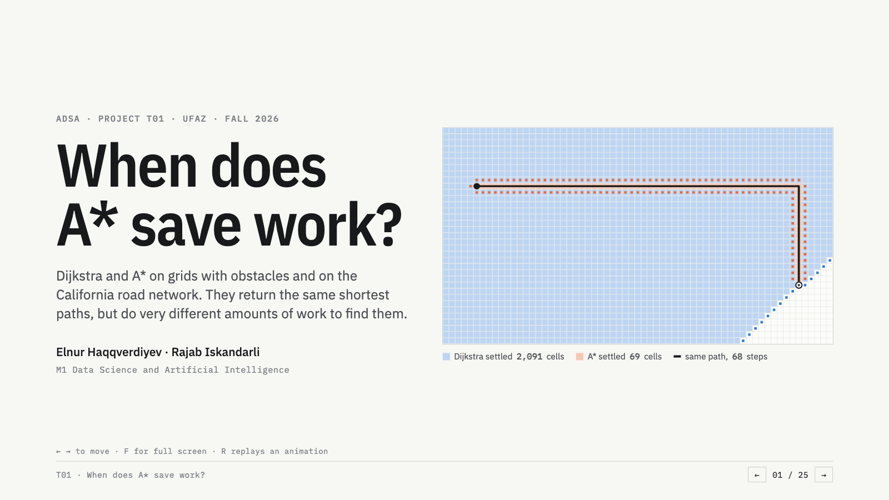
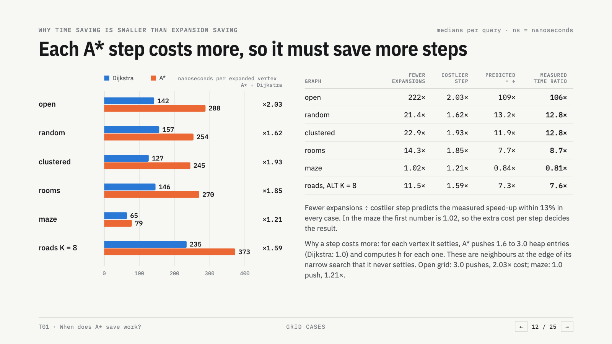

# When does A* save work?


Project T01 for **Advanced Data Structures and Algorithms**, M1 Data Science and
Artificial Intelligence, UFAZ, Fall 2026.

Pair: **Elnur Haqqverdiyev – Rajab Iskandarli**.

This repository contains the C++20 implementation, the correctness tests, the
frozen experimental protocol, the raw measurements and the analysis for the
question:

> How do the structure of a graph and the heuristic change the number of
> expanded vertices and the runtime of A* compared with Dijkstra, on unit-cost
> grids with obstacles and on a real-life road graph?

The short answer is in [`RESULTS.md`](RESULTS.md).  The pre-registered
predictions are in [`HYPOTHESES.md`](HYPOTHESES.md), and the protocol frozen
before the main run is in [`PROTOCOL.md`](PROTOCOL.md).

[](#animated-defence-deck)

## Results at a glance

Both algorithms return the same shortest path; what differs is the work.

> **time = expansions × cost per expansion.**  A* settles fewer vertices, but
> each one costs more (it pushes 1.6–3.0 heap entries per settled vertex and
> evaluates `h` for each, against 1.0 for Dijkstra).  A* is faster only when
> the first saving beats the second cost.

Paired medians, Dijkstra ÷ A* (higher = A* better), frozen run and the
independent replication on a second machine:

| graph | fewer expansions | faster, original | faster, replication |
|---|---:|---:|---:|
| open grid | 222× | 106× | 209× |
| random 20% | 21.4× | 12.8× | 15.6× |
| clustered 30% | 22.9× | 12.8× | 12.5× |
| rooms | 14.3× | 8.7× | 8.6× |
| maze | 1.02× | **0.81×** (A* slower) | **0.79×** |
| California roads, ALT K = 8 | 11.5× | 7.6× | 10.6× |
| California roads, ALT K = 16 | 22.4× | 13.5× | 15.0× |

Details: [`RESULTS.md`](RESULTS.md) (frozen run),
[`results/replication_macos/RUN_LOG.md`](results/replication_macos/RUN_LOG.md)
(replication, including which smaller effects did not hold).



## Animated defence deck

A 25-slide animated deck (live Dijkstra/A* races on each grid family and on a
road network, every chart drawn from the measured data) lives in
[`slides/web/`](slides/web/).  It is a single HTML file with its fonts beside
it, so it runs offline:

```bash
./scripts/serve_slides.sh            # → http://localhost:8000
OPEN=1 ./scripts/serve_slides.sh     # same, and open the browser
```

Keys: `←`/`→`/`Space` to move, `F` for full screen, `R` to replay an animation;
`#slide-12` in the URL jumps to a slide.  The static LaTeX decks are
`slides/defence.pdf` and `slides/checkpoint.pdf`.

## Quick start

Requirements: a C++20 compiler with OpenMP (tested with GCC 13.3 and Apple
Clang 21), CMake 3.20+, Python 3.10+ with `numpy`, `pandas`, `matplotlib` and
`scipy`, and `curl`/`gzip` for the SNAP data.

```bash
cmake -S . -B build -DCMAKE_BUILD_TYPE=Release
cmake --build build -j "$(nproc)"
./build/test_core
```

On macOS, install OpenMP first (`brew install libomp`) and point CMake at it:

```bash
cmake -S . -B build -DCMAKE_BUILD_TYPE=Release -DOpenMP_ROOT="$(brew --prefix libomp)"
cmake --build build -j "$(sysctl -n hw.ncpu)"
./build/test_core
```

The core tests run without the real graph; the real-graph sample is skipped
until the graph is prepared.  To download, decompress and preprocess the real
graph (the script builds the C++ tools if needed):

```bash
./download_data.sh
```

To rerun the full frozen experiment and the analysis:

```bash
./scripts/run_experiments.sh
```

The exploratory extensions (heuristic informativeness and weighted A*) are
separate from the frozen protocol:

```bash
./scripts/run_novelty.sh
```

The OpenMP batch-throughput study is also separate from the frozen protocol:

```bash
./scripts/run_omp.sh
```
`run_experiments.sh` calls `download_data.sh` automatically if the graph is
missing.

The script pins the process to CPU 0 with `taskset`, applies the 4 GiB memory
cap from the protocol, runs a 30-query real-graph validation, then runs the grid
and real benchmarks.  On the development machine the timed part took about
2 min 45 s; the full script including compilation and analysis is under 5 min.

If the binaries and data already exist, the experiment can be run directly:

```bash
./build/astar_research benchmark-grid \
    --out results/grid.csv --sizes 128,256,512,1024 \
    --families open,random,clustered,rooms,maze \
    --reps 3 --per-band 5 --seed 20261030

./build/astar_research benchmark-real \
    --graph data/roadNet-CA.bin \
    --landmarks data/roadNet-CA.alt16.bin \
    --out results/real.csv \
    --reps 5 --per-band 10 --main-k 8 --seed 20261030

python3 scripts/analyze_results.py
./scripts/build_report.sh      # IEEE two-column PDF
```

## Real data

Source: SNAP, **roadNet-CA** (California road network),
<https://snap.stanford.edu/data/roadNet-CA.html>.

The SNAP page reports 1,965,206 nodes and 2,766,607 edges.  We read the
5,533,214 directed arcs, symmetrise each road segment, remove self-loops and
duplicates, take the largest connected component, and compact the vertex ids.
The experimental graph has:

- **1,957,027 vertices**
- **2,760,388 undirected edges** (5,520,776 CSR arcs)
- average degree ≈ 2.82
- unit edge weight (one per road segment / hop)

SNAP does not provide road length or travel time, so we do **not** invent a
weighted interpretation.  The real-graph result is a hop-count result, just as
the grid result is a unit-cost result.

The generated data files are intentionally **not** shipped in the archive, so
the project can be zipped without the 278 MB data directory.  `download_data.sh`
recreates them idempotently: `data/roadNet-CA.txt.gz` is the original download,
`data/roadNet-CA.txt` is the decompressed edge list, `data/roadNet-CA.bin` is the
compact CSR graph and `data/roadNet-CA.alt16.bin` contains the 16 landmark
distance tables.  The binaries are generated, not hand-edited.

## Grid families

All grids are square, row-major, 4-neighbour, unit cost.  A blocked cell is an
isolated vertex; only the largest connected component is used for query
selection.

| family | generation |
|---|---|
| `open` | no obstacles |
| `random` | independent blocked cells with probability 0.20 |
| `clustered` | 30% blocked in random circular blobs, radius 3 .. min(W,H)/20, 85% fill inside a blob |
| `rooms` | walls every 16 cells; one door per room-boundary segment; solid wall intersections |
| `maze` | perfect maze from iterative randomised DFS on odd cells |

Sizes 128, 256, 512, 1024.  The actual blocked fraction is reported in the CSV,
because the clustered and room generators do not hit their nominal values
exactly.

## What is implemented

### Graph (`include/graph.hpp`, `src/graph.cpp`)

`Graph` is a compact CSR graph:

- `offsets` of length `n+1`, `targets` and `weights` of length `m`;
- memory `O(n+m)`;
- `degree(u)` O(1), outgoing-edge iteration O(degree(u));
- `GraphBuilder` sorts and deduplicates an edge list in `O(m log m)`;
- a documented binary format (`ASTARGR1`) for reproducible graph loading.

### Binary heap (`include/binary_heap.hpp`)

Array-based binary min-heap with duplicate entries and lazy deletion:

- `push`, `pop`: `O(log n)` worst case;
- `top`, `size`, `empty`, `clear`: `O(1)`;
- no decrease-key: a popped entry is stale if its `g` is no longer the current
  distance, or if the vertex is already closed;
- two deterministic tie-breaks: `NodeId` = `(f,id)`, `LargerG` = `(f,-g,id)`.

### Searches (`include/search.hpp`, `src/search.cpp`)

A single `shortest_path` routine implements both algorithms.  A null heuristic
is Dijkstra; a non-null heuristic is A*.  This guarantees that the heap, edge
relaxation, counter updates and stopping rule are identical.

- Dijkstra: `f=g`, `h=0`.
- A*: `f=g+h(v)`.
- Both stop when the target is popped and settled.
- The heuristic is prepared once per query.
- With a consistent heuristic, settled vertices never need reopening; both
  heuristics used here are consistent.  The optional weighted mode
  `f=g+epsilon*h` enables reopening and is used only in the exploratory
  weighted-A* experiment.
- `SearchScratch` reuses distance/closed/parent arrays and resets them in O(1)
  with a generation stamp.  One scratch object is created per treatment so heap
  capacity cannot leak between treatments.
- Timed runs do not reconstruct paths; validation runs do.

### Heuristics (`include/heuristic.hpp`, `src/heuristic.cpp`)

- **Manhattan** on grids:
  `h(v,t)=|row(v)-row(t)|+|col(v)-col(t)|`.
  It is admissible and consistent for 4-neighbour unit grids, with or without
  obstacles.
- **ALT** on the real graph:
  `h(v,t)=max_L |d(L,v)-d(L,t)|`.
  For each landmark, the triangle inequality gives admissibility, and the same
  inequality on an edge gives consistency.
- Sixteen landmarks are selected by deterministic farthest-point sampling;
  each landmark distance table is a BFS over the unweighted graph.  The main
  real treatment uses the first 8; the analysis also reports 1, 4 and 16.

### Oracles (`include/oracle.hpp`, `src/oracle.cpp`)

- BFS distances for unweighted graphs, independent of the heap searches;
- Floyd–Warshall for hand-sized weighted graphs;
- edge-by-edge path validation;
- largest-connected-component extraction by union-find.

### Experiments (`include/experiments.hpp`, `src/experiments.cpp`)

- query selection from BFS distance bands (short/medium/long), independent of
  Dijkstra/A*;
- paired benchmark runner and raw CSV writer;
- 30-query real validation sample;
- documented counters: expansions, pushes, pops, stale pops, relaxed arcs,
  improvements, heuristic calls and heap peak.

## Counter definitions

See `PROTOCOL.md` section 5.  In short:

- **expanded**: popped, not stale, not already closed, and therefore settled
  (the target counts when popped);
- **pushed**: every heap insertion, including the source and each successful
  decrease;
- **stale_popped**: popped entry whose `g` is not the current tentative distance,
  or whose vertex is already closed;
- **relaxed_edges**: outgoing arcs inspected from expanded vertices;
- **improved**: successful strict distance decreases after source initialisation;
- **heuristic_calls**: calls to `Heuristic::estimate` (zero for Dijkstra);
- **heap_peak**: maximum number of entries in the heap.

## Output layout

```
results/grid.csv                 raw grid runs (2700 rows)
results/real.csv                 raw real-graph runs (900 rows)
results/summary_*.csv            paired summaries and CIs
results/paired_*.csv             per-query paired ratios
results/analysis.md              generated tables and figures
results/RUN_LOG.md               environment, commands, completion status
results/grid_diagnostics.csv      heuristic-error diagnostics, 300 grid queries
results/real_diagnostics.csv      heuristic-error diagnostics, 30 road queries
results/weighted_maze.csv         weighted A* epsilon sweep on mazes
results/omp_scaling.csv           OpenMP batch wall-clock times
results/omp_tasks.csv             OpenMP per-query latencies
results/novelty.md                generated novelty tables
results/omp.md                    generated OpenMP tables
figures/novelty_*.png             novelty figures
figures/omp_*.png                 OpenMP figures
NOVELTY.md                        summary of the exploratory extensions
download_data.sh                 downloads/prepares SNAP roadNet-CA
scripts/run_novelty.sh           heuristic + weighted-A* extensions
scripts/run_omp.sh               OpenMP batch-scaling extension
figures/*.png                    figures used in the defence slides
HYPOTHESES.md                    predictions written before the main run
PROTOCOL.md                      frozen protocol
RESULTS.md                       answer to the research question
report/report.tex                IEEE two-column report source
report/report.pdf                IEEE two-column report (7 pages)
slides/checkpoint.tex            checkpoint deck source
slides/checkpoint.pdf            rendered checkpoint deck
slides/defence.tex               defence deck source
slides/defence.pdf               rendered defence deck
slides/web/index.html            animated defence deck (offline; fonts in slides/web/fonts/)
scripts/serve_slides.sh          serves the animated deck at http://localhost:8000
results/replication_macos/       full rerun on a second machine (Apple M4 Pro)
scripts/run_replication_macos.sh full pipeline on macOS into results/replication_macos/
scripts/analyze_replication.py   runs the analysis scripts on the replication folder
docs/                            preview images for this README
```

## Replication on a second machine

The whole pipeline was rerun on an Apple M4 Pro (macOS, Apple Clang, libomp)
with the same code, seeds and commands, writing only to
`results/replication_macos/`:

```bash
./scripts/run_replication_macos.sh
```

The road graph and landmark files are byte-identical to the frozen run.  The
grids and query pairs are not: `std::mt19937_64` is fully specified, but the
standard distributions and `std::shuffle`/`std::sample` are
implementation-defined, so libc++ draws a new sample from the same design.
The main effects (family ordering, the maze slowdown, more landmarks always
better, heuristic error vs speed-up, OpenMP scaling) held; the distance-band
trends, the per-size H3 ordering, weighted A* at `128^2` and the H7 median did
not.  The H7 median depends only on how many targets lie below the source:
`node_id` prefers low cell ids (upper rows) and expands more on 72 of 73
below-target queries and on 0 of 47 others.  See
[`results/replication_macos/RUN_LOG.md`](results/replication_macos/RUN_LOG.md).

## Reproducibility details

- Main seed: `20261030`.
- Graph seed for a cell: `20261030 ^ fnv1a64("graph_" + graph_id)`.
- Query seed: `20261030 ^ fnv1a64("query_" + graph_id)`.
- Grid query selection: 5 sources x 3 bands = 15 pairs per graph.
- Real query selection: 10 sources x 3 bands = 30 pairs.
- Repeats: 3 for grids, 5 for real.
- Warm-up: one untimed run per treatment per graph.
- Timing: `std::chrono::steady_clock`, nanoseconds, only around
  `shortest_path`; input construction and query selection are outside.
- Time cap: 30 s per search, checked every 4096 pops; no timeouts occurred.
- Memory cap: 4 GiB per process (`ulimit -v 4194304` on Linux).
- Environment used for the reported data: Intel Core Ultra 9 285H, 16 logical
  CPUs, 30 GiB RAM, Ubuntu 24.04.5 on WSL2, kernel 6.6.87.1, GCC 13.3.0,
  CMake 4.4.2, Release build.

## Exploratory extensions

Three post-freeze analyses are included and clearly labelled exploratory:

1. **Heuristic informativeness.** Reverse BFS measures the true remaining
   distance on sampled vertices; the normalised heuristic error has Spearman
   correlation -0.81 with the paired time ratio across 300 grid queries.  This
   explains why the maze loses: Manhattan is admissible but uninformative.
2. **Price of optimality.** Weighted A* (`f = g + epsilon*h`) is swept on
   mazes.  At `1024^2` with `epsilon=50` it is 1.68x faster (short queries
   3.43x), and the path cost remains exactly optimal because a perfect maze has
   a unique simple path.  At `128^2` the overhead still loses.
3. **Batch throughput with OpenMP.** Independent queries scale to 9.73x at 16
   threads (61% efficiency); per-query latency inflates by 18--21%, and the A*
   advantage remains.  This is a throughput result, not single-query speedup.

See `NOVELTY.md`, `results/novelty.md`, `results/omp.md`, and the report/talk
sections.

## Limitations

- Only one real graph is used.  It is a sparse road network with unit hop costs;
  the result should not be generalized to weighted road travel times without
  repeating the experiment.
- The grid families are synthetic controls.  They isolate structure, but they
  are not a sample of real maps.
- The real graph's edge weights are not physical lengths or travel times.
- The timing is single-machine wall-clock time; the analysis reports medians,
  IQRs, bootstrap intervals and within-query repeat variation rather than a
  single number.
- A* is compared with Dijkstra using the same binary heap and lazy deletion;
  the conclusion is about this implementation, not about every possible
  priority queue.
- The real graph is undirected after symmetrisation.  One-way roads are not
  modelled.

## Performance-mode sensitivity

The main run was collected with the host in its lowest performance/power mode.
Absolute times are mode-specific; the paired ratios are the intended result.
A short subset check can be run in two modes without overwriting the frozen
main CSVs:

```bash
./scripts/check_performance_mode.sh low
# switch the host to the higher performance mode
./scripts/check_performance_mode.sh high
python3 scripts/compare_performance_modes.py low high
```

The comparison reports the median high/low time-ratio change and verifies that
expansion ratios are unchanged.  The main experiment remains the frozen
`results/grid.csv` and `results/real.csv`.
